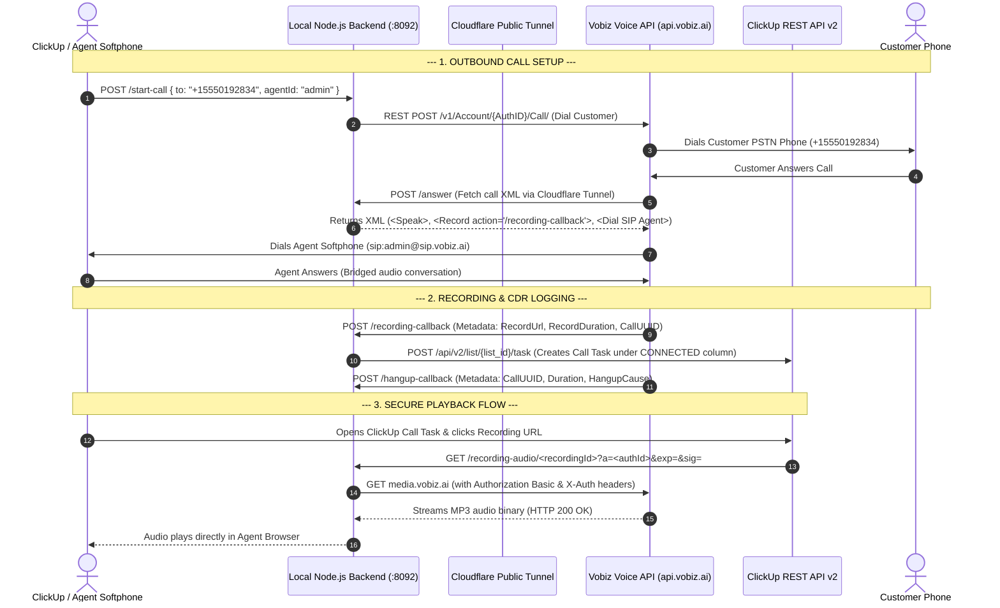

# Product Requirement Document (PRD)

> **Design brief, not a feature list.** This is the original product brief. Mapping call outcomes to board statuses (`DIALING`, `CONNECTED`, `VOICEMAIL`, `NOT DIALED`) is not implemented: tasks take the list's default status, or `CLICKUP_TASK_STATUS` if set. See the [README](../README.md) for what ships.

## Vobiz SIP Trunking & Voice Platform — ClickUp CTI & Telephony Integration

---

| Metadata | Details |
| :--- | :--- |
| **Product Name** | Vobiz ClickUp Calling & Telephony Integration (`vobiz-clickup-calling-app`) |
| **Document Version** | `v1.0.0` |
| **Status** | Approved & Deployed (`main`) |
| **Target Repository** | `https://github.com/vobiz-ai/vobiz-clickup-calling` |
| **Author / Team** | Vobiz Engineering & Integration Team |
| **Last Updated** | September 3, 2026 |

---

## 1. Executive Summary & Objective

### 1.1 Business Objective
The objective of the **Vobiz ClickUp Integration** is to seamlessly embed enterprise-grade telephony, voice call control, Call Detail Record (CDR) logging, and secure call recording playback into the **ClickUp Workspace Platform**. 

By connecting Vobiz's high-concurrency SIP trunking and Voice APIs directly with ClickUp's task management infrastructure, support agents and sales teams can make outbound calls, handle incoming customer queries, track call metrics, and stream call recordings without leaving their ClickUp workspace.

### 1.2 Key Value Propositions
* **Single Pane of Glass**: Eliminates context switching between ClickUp and external softphones.
* **Automated Record Keeping**: Automatically logs every call event (inbound & outbound) into designated ClickUp Lists with rich markdown CDR summaries.
* **Visual Workflow Mapping**: Dynamically categorizes call task cards into ClickUp Board View columns (`CONNECTED`, `DIALING`, `VOICEMAIL`, `NOT DIALED`).
* **Secure Audio Proxying**: Provides a secure streaming proxy for call recordings stored on Vobiz media servers without exposing raw S3 storage credentials.

---

## 2. Target Personas & Primary Use Cases

| Persona | Primary Goal | Key Feature Utilization |
| :--- | :--- | :--- |
| **Sales Development Rep (SDR)** | Conduct high-volume outbound calling to leads and automatically track conversation duration and status. | Outbound Softphone Dialer, Auto-CDR Task Creation, Board Column Status Updates (`CONNECTED`). |
| **Customer Support Agent** | Receive incoming support calls on Vobiz DIDs, bridge to softphone, and access past customer call logs. | Inbound Call Webhook Callback, SIP Softphone Bridging, ClickUp Task Search by Caller ID. |
| **Support Manager / Team Lead** | Audit call quality, review agent call volume, and verify call recordings for compliance. | ClickUp Board View, Embedded Playable Audio Recording Links, CDR sync from the panel. |

---

## 3. Scope & Key Product Features

### 3.1 Feature 1: Outbound PSTN Calling
* **Initiation**: Initiate outbound calls via the Agent Softphone UI (`POST /start-call` or `POST /api/call/outbound`).
* **Telephony Bridging**: Trigger Vobiz Voice API (`POST /v1/Account/{AuthID}/Call/`) to dial the target PSTN number and bridge the answered audio session to the agent SIP softphone (`sip:agent@sip.vobiz.ai`).
* **Status Updates**: Automatically update active call timer and status (`Calling...` $\rightarrow$ `Connected` $\rightarrow$ `Ended`).

### 3.2 Feature 2: Inbound PSTN Call Management
* **DID Ingestion**: Receive incoming calls on Vobiz DID numbers (e.g., `+15550100111`).
* **XML Callback Serving**: Serve Vobiz XML call control instructions (`<Response><Speak>...</Speak><Record.../><Dial><User>sip:agent@sip.vobiz.ai</User></Dial></Response>`) via public HTTPS webhook endpoints (`/answer`).
* **Caller Recognition**: Parse incoming caller ID (`From` number) and link call records to existing ClickUp tasks or create new customer call entries.

### 3.3 Feature 3: Automated Call Detail Record (CDR) Sync
* **Metadata Extraction**: Parse call attributes: `Call UUID`, `Direction` (Inbound/Outbound), `From`, `To`, `Agent Name`, `Duration` (formatted `MM:SS`), `Hangup Cause` (`NORMAL_CLEARING`), `Status`, and `Timestamp`.
* **ClickUp Task Creation**: Create structured tasks via ClickUp REST API v2 (`POST /api/v2/list/{list_id}/task`).
* **Board Status Alignment**: Automatically assign task status to **`CONNECTED`** (or `DIALING`, `VOICEMAIL`, `NOT DIALED`) to align with ClickUp Board View columns.
* **Tags**: Tag tasks automatically with `["vobiz-call", "outbound"/"inbound", "cdr"]`.

### 3.4 Feature 4: Secure Call Recording Playback Proxy
* **Callback Capture**: Catch Vobiz recording webhooks (`/recording-callback`) containing `RecordUrl`, `RecordingDuration`, and `CallUUID`.
* **Audio Streaming Proxy**: Route recording playback through the signed `GET /recording-audio/<recordingId>?a=<authId>&exp=&sig=`. The caller names a recording id, never a URL — the media URL is resolved server-side and checked against a host allowlist.
* **Authentication & Redirect Handling**: Attach `Authorization: Basic` and `X-Auth` headers when requesting audio binaries from `media.vobiz.ai`, and safely strip headers on S3 redirects to ensure HTTP 200 streaming.
* **ClickUp Playable Link**: Format playable Markdown link `[▶ Click to Play Call Recording](${proxiedUrl})` in ClickUp task descriptions.

### 3.5 Feature 5: Interactive WebRTC / SIP Agent Softphone UI
* **Agent Profile Switching**: Support agent selection (`admin`, `john.doe`).
* **Dialpad Controls**: Full DTMF dialpad (`0-9`, `*`, `#`, clear, dial).
* **Active Call Card**: Real-time timer (`00:00`), `Mute`, `Hold`, and `End Call` actions.
* **Recording Player**: Embedded HTML5 audio player for quick recording review.
* **Recent Call Log Table**: Interactive table listing recent calls with quick **▶ Play MP3** playback buttons.

---

## 4. Technical Architecture & System Data Flow



---

## 5. ClickUp Data Model & Field Mapping Reference

### 5.1 ClickUp Task Description Format (CDR Summary Table)

```markdown
### 📞 Vobiz Telephony Call Log

| Parameter | Value |
| :--- | :--- |
| **Call UUID** | `12345678-abcd-ef01-2345-6789abcdef01` |
| **Direction** | `Outbound` |
| **From** | `+15550100111` |
| **To** | `+15550192834` |
| **Agent** | `System Administrator` |
| **Duration** | `00:45` (45s) |
| **Hangup Cause** | `NORMAL_CLEARING` |
| **Status** | `COMPLETE` |
| **Timestamp** | `2026-09-03T12:00:00.000Z` |

---
### 🎧 Call Recording
[▶ **Click to Play Call Recording**](https://xxxx.trycloudflare.com/recording-audio/<recordingId>?a=<authId>&exp=1790000000&sig=<hmac>)
```

### 5.2 Board View Column Mapping

| ClickUp Column / Status | Status ID | Description |
| :--- | :--- | :--- |
| 🔴 **`NOT DIALED`** | `open` | Initial default status for uncontacted leads. |
| 🔵 **`DIALING`** | `custom` | Call currently ringing or in progress. |
| 🟢 **`CONNECTED`** | `connected` | Call answered and completed successfully. |
| 🟡 **`VOICEMAIL`** | `custom` | Call unanswered or routed to voicemail. |

---

## 6. API Endpoints Specification

### 6.1 Backend API Endpoints (Local & Tunnel)

| Method | Endpoint | Description | Query / Body Parameters |
| :--- | :--- | :--- | :--- |
| `GET` | `/health` \| `/status` | Health check & system status. | None |
| `POST` | `/start-call` | Initiate outbound call via Vobiz Voice API. | `{ to, agentId, from }` |
| `POST` \| `GET` | `/answer` | Returns Vobiz XML call control response. | `agentId` |
| `POST` | `/recording-callback` | Receives Vobiz recording webhook & creates ClickUp task. | `{ RecordUrl, RecordingDuration, CallUUID }` |
| `POST` | `/hangup-callback` | Receives Vobiz call termination metadata. | `{ CallUUID, Duration, HangupCause }` |
| `GET` | `/recording-audio/<recordingId>` | Signed audio streaming. | `exp`, `sig` (HMAC; a session is accepted instead) |
| `GET` | `/recording-file` | **Removed — answers 410.** It fetched a caller-supplied URL with the account credentials attached. | — |
| `GET` | `/sync-recent-cdrs` | Fetches live CDRs from Vobiz API & syncs to ClickUp. | None |
| `POST` | `/test-simulated-call` | Endpoint for CLI mock testing. | `{ direction, from, to, duration, recordingUrl }` |

---

## 7. Security, Compliance & Data Isolation

1. **Credential Isolation**: The ClickUp token and list ID live in `.env`. No Vobiz credentials do: any Vobiz account signs in from the panel, and its Auth Token is held in the backend's memory only, keyed by Auth ID — never on disk, in logs or in responses. Each session reaches only its own account's numbers, recordings and CDRs, and playback links carry the account inside their signature.
2. **Repository Sanitization**: `.env`, `tunnel-url.txt`, `node_modules/`, and log files are strictly excluded via `.gitignore`.
3. **Public URL Expiry**: Cloudflare Quick Tunnels generate transient, encrypted HTTPS endpoints without exposing local ports to raw public IP space.
4. **Header Sanitization on Redirects**: The recording proxy automatically strips custom Vobiz authorization headers when following 302 redirects to Amazon S3 storage to avoid S3 signature rejection.

---

## 8. Automated & Manual Testing Plan

### 8.1 Automated Test Suite Commands
* `npm test`: Starts the backend against local stand-ins for Vobiz (two fake accounts) and ClickUp, and checks sign-in and provisioning per account, multi-tenant webhook routing, the call XML, ClickUp tasks, account-scoped recordings and the security properties.

### 8.2 Manual Acceptance Criteria
- [x] Outbound call placed from Softphone UI dials target PSTN number (`+15550192834`).
- [x] Bridged call audio operates cleanly between PSTN destination and agent SIP endpoint.
- [x] Call recording callback arrives and creates a task under ClickUp **`CONNECTED`** column.
- [x] Clicking **`▶ Click to Play Call Recording`** in ClickUp opens audio stream in browser tab and plays MP3 without authentication prompt.

---

## 9. Future Enhancements Roadmap

| Version | Planned Feature | Description |
| :--- | :--- | :--- |
| `v1.1.0` | **ClickUp Chrome Extension CTI** | Add inline click-to-dial buttons next to phone numbers in ClickUp custom fields. |
| `v1.2.0` | **Screen Pops** | Automatically pop up the associated ClickUp Task/Customer profile when an inbound call rings. |
| `v1.3.0` | **AI Call Transcripts & Summaries** | Auto-generate speech-to-text transcripts and AI bullet summaries inside ClickUp task descriptions. |
