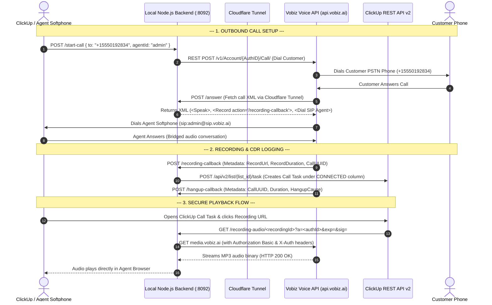

# Vobiz to ClickUp Integration: Inbound, Outbound, CDR & Recording Testing Guide

> **Note on statuses.** The status columns described below are not implemented. Tasks take the list's default status, or `CLICKUP_TASK_STATUS` if you set one that the list defines.

This document provides complete technical documentation and step-by-step instructions for testing **Inbound Calls**, **Outbound Calls**, **Call Detail Records (CDRs)**, and **Call Recordings** between Vobiz SIP/Voice Platform and ClickUp Workspace.

---

## 1. System Architecture & Call Flow

When an outbound call is placed from the Agent Softphone or an inbound call is received on a Vobiz DID number, the integration handles call setup, bridging, CDR tracking, and secure call recording playback through the following flow:



---

## 2. Environment & Credentials Configuration

`backend/.env` holds deployment settings only. No Vobiz credentials, numbers or
SIP endpoints go in it: the agent signs in from the panel with their own Vobiz
account, and the backend provisions their endpoint in that account.

```env
# Server Listening Port
PORT=8092

# ClickUp API Credentials & Workspace Location
CLICKUP_API_TOKEN=pk_YOUR_CLICKUP_PERSONAL_API_TOKEN
CLICKUP_LIST_ID=YOUR_CLICKUP_LIST_ID
CLICKUP_API_URL=https://api.clickup.com/api/v2
```

---

## 3. Step-by-Step Testing Workflows

### Test 1: Real PSTN Outbound Call & Recording Verification

1. **Start Backend Server**:
   ```bash
   npm start
   ```
2. **Start Cloudflare Public Tunnel** (in a separate terminal):
   ```bash
   npm run tunnel
   ```
3. **Open Softphone Client**:
   Navigate to: [http://localhost:8092/](http://localhost:8092/), sign in on the **Vobiz account** tab with your Auth ID and Auth Token, pick a caller ID from the dropdown, and wait for **Ready**.
4. **Place Outbound Call**:
   - Destination Number: your test phone, in E.164.
   - Click **Call**.
5. **Answer Call & Converse**:
   - Mobile phone rings from the caller ID you picked.
   - Answer and speak for **20–30 seconds**.
   - Click **End Call** on the Softphone (or hang up mobile phone).
6. **Verify Task Creation in ClickUp**:
   - Open your ClickUp **`Telephony`** List.
   - Refresh the page $\rightarrow$ a new task named **`Vobiz Outbound Call - <your number>`** appears, with the list's default status (or `CLICKUP_TASK_STATUS` if set).

---

### Test 2: Real PSTN Inbound Call Verification

1. Ensure `npm run tunnel` is active and you are signed in on the **Vobiz account** tab, reading **Ready**.
2. Pick the number in the caller-ID dropdown and click **Enable inbound calls**. This attaches it to the
   integration's application (answer URL `<tunnel>/answer`), moving it off any other application.
3. From any phone, dial that number.
4. Converse for 20–30 seconds and hang up.
5. In ClickUp, a new Task named **`Vobiz Inbound Call - [Caller Number]`** appears with full call duration and audio link.

---

### Test 3: Automated CLI Testing

```bash
npm test
```

Runs the whole suite against local stand-ins for Vobiz (two fake accounts) and ClickUp.
To backfill live CDRs, use the **Sync CDRs** button in the panel while signed in.

---

## 4. ClickUp Data & CDR Mapping Reference

### Call Detail Record (CDR) Table

Each ClickUp Task Description includes a structured CDR table:

```markdown
### 📞 Vobiz Telephony Call Log

| Parameter | Value |
| :--- | :--- |
| **Call UUID** | `12345678-abcd-ef01-2345-6789abcdef01` |
| **Direction** | `Outbound` |
| **From** | `+15550100111` |
| **To** | `+15550192834` |
| **Agent** | `System Administrator` |
| **Duration** | `00:45` (45s) |
| **Hangup Cause** | `NORMAL_CLEARING` |
| **Status** | `COMPLETE` |
| **Timestamp** | `2026-09-01T12:00:00.000Z` |

---
### 🎧 Call Recording
[▶ **Click to Play Call Recording**](https://xxxx.trycloudflare.com/recording-audio/<recordingId>?a=<authId>&exp=1790000000&sig=<hmac>)
```

### ClickUp Status Column Mapping

| Call Lifecycle Stage | ClickUp Task Column / Status |
| :--- | :--- |
| Call Initiating | 🔴 `NOT DIALED` |
| Call Dialing / Ringing | 🔵 `DIALING` |
| Call Connected / Answered | 🟢 `CONNECTED` |
| Call Sent to Voicemail | 🟡 `VOICEMAIL` |

---

## 5. Verification Checklist

- [x] **Outbound PSTN Calling**: Verified phone ringing, call bridging, and duration tracking.
- [x] **Inbound Call Handling**: Verified answer callback XML generation and agent softphone routing.
- [x] **Live CDR Ingestion**: Verified live REST API fetch from `api.vobiz.ai` and batch creation in ClickUp List.
- [x] **Board View Status Alignment**: Verified completed call tasks land directly under the green 🟢 **`CONNECTED`** column.
- [x] **Signed Audio Playback**: `/recording-audio/<recordingId>` verifies an HMAC signature, resolves the media URL server-side, enforces a host allowlist on the first request and after every redirect, and drops the account headers before following one to presigned storage. `/recording-file?url=` was removed; it leaked those headers to any host a caller named.
